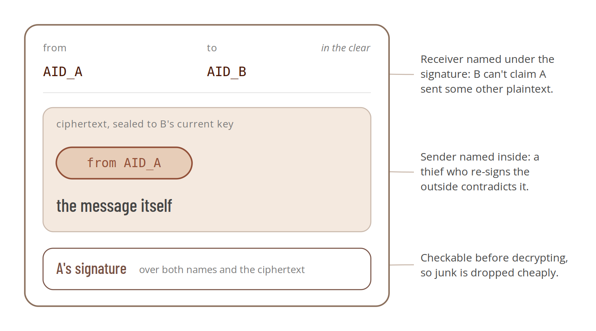
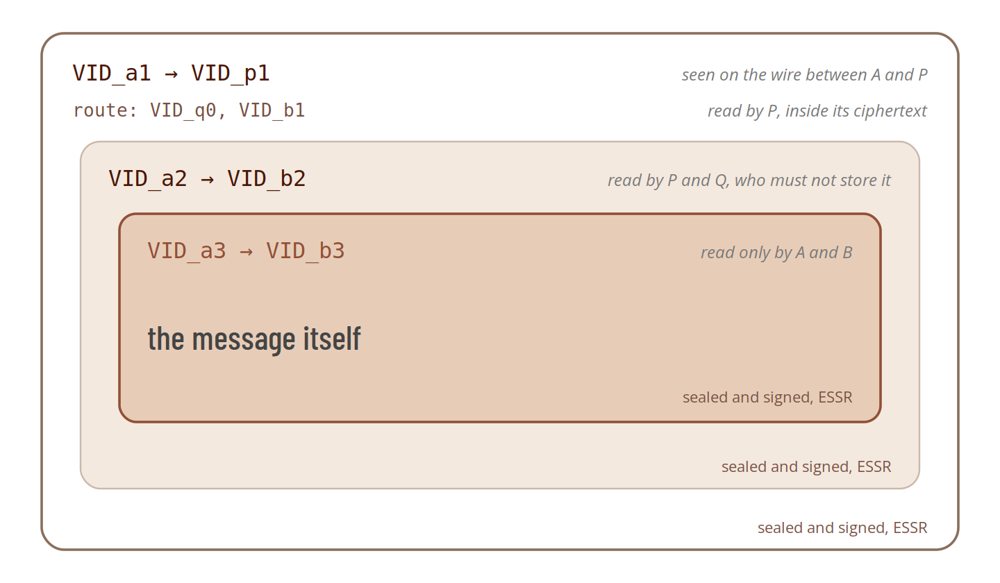
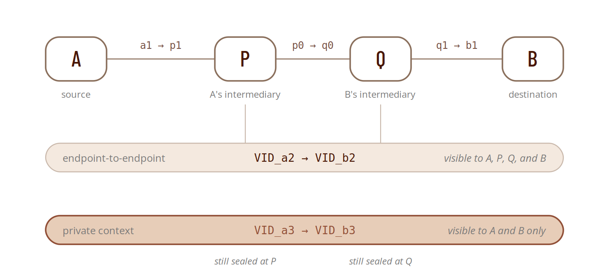

In 2021 I got a new phone number and discovered that my Signal account couldn't come with me. Signal's security was bound to the number, which my employer rented from a carrier, and Signal wouldn't move the binding. (It has since added a migration path.) I wrote about the experience at the time, and the lesson I drew was that secure messaging wasn't the hard part. The hard part was owning the thing the security attaches to. What I wanted was to "switch the phone number Signal knows me by, but not Alice's perception of the secure and private pipe we share" [1].

That wish has a long technical tail. A channel bound to something you own and can rekey has to answer questions an ordinary encrypted pipe never faces. How do you know the keys you're using are still the right ones? Who can tell that you and Alice are talking at all? What happens to your history when a key is compromised? Two efforts in the decentralized identity world have tried to answer those questions with particular care. One is SPAC, Samuel Smith's design for secure messaging between KERI identifiers. The other is the Trust Spanning Protocol, or TSP, which the Trust Over IP Foundation (ToIP) built from many of the same ideas.

This primer explains both, and how one became the other. I watched part of that history up close: I was in the room when TSP was proposed at ToIP and attended a number of its early meetings. So some of what follows is my account of how the thinking in this space evolved, and where I offer my own judgment I say so. SPAC's ideas are Sam's, and I've tried to present them as he does, without claiming to speak for him.

## 1. From channels to identifiers

Most secure channels bind their security to something other than the parties. TLS binds it to a server certificate and to a session that ends when the connection does. Signal, in my case, bound it to a phone number. Both work well for what they were built to do, and neither gives two parties a durable relationship that they own and can carry from one transport, device, or key to the next.

DIDComm was the decentralized identity community's first serious attempt to fix that. I co-invented its first version in 2017 with a colleague at Evernym, in design documents that were never published. The public record begins with Hyperledger Indy proposals in 2018, continues in a family of Hyperledger Aries RFCs in 2019 [2, 3, 4], and reaches DIDComm Messaging v2 at the Decentralized Identity Foundation (DIF), ratified in 2022. Sam Curren co-edited v2 and evolved it a great deal [5]. DIDComm's central move was to bind messages to decentralized identifiers (DIDs). In DIDComm v2 the sender's `from` field "MUST be a string that is a valid DID or DID URL", and "When a message is encrypted, the sender key MUST be authorized for encryption by this DID" [5]. Keys come from the DID's document, so when the keys behind a DID change, the relationship survives. DIDComm deliberately leaves that change to the DID's own method: "Changes to keys and endpoints are the concern of each DID method and are utilized but not managed by DIDComm Messaging" [5]. For the rarer case of moving a relationship to a different DID, it defines a signed hand-off called `from_prior`.

DIDComm also had envelopes, which is the metaphor I used for it in an earlier primer [6]. A message can be authenticated and encrypted to its recipient ("authcrypt"), encrypted without revealing the sender ("anoncrypt"), or signed and then encrypted. Messages travel through mediators, and the sender "wraps the message once for each hop that has cryptographic consequences in the path" [5]. Each mediator opens one layer, learns the next hop, and passes on a blob it can't read. "No party is required to know the full route of a message" [5].

So the shape that SPAC and TSP would later formalize — identifiers instead of keys, nested envelopes, intermediaries that see only what they must — was familiar to many of us in the ToIP conversations where TSP began. I think DIDComm's experience shaped those conversations. It shaped mine, at least. But two of its design choices point in a different direction from where SPAC went, and the contrast is the clearest way into SPAC's thinking.

The first choice concerns authenticity. DIDComm authenticates senders by default with authenticated encryption, which convinces the recipient without producing anything the recipient can show to others. That's a privacy feature: "DIDComm Encrypted messages are repudiable" [5], and the Aries RFC on repudiation, which I wrote, warns that "over-signing creates a digital exhaust that can lead to serious long-term privacy problems" [7]. Signatures are opt-in. SPAC turns this priority around. As section 2 explains, it puts strong, verifiable authenticity first and treats privacy as what you get after authenticity and confidentiality are secured.

The second choice concerns key state. DIDComm trusts whatever a DID method says the current keys are. That's a sensible boundary for a messaging spec, but it means a DIDComm relationship is only as robust as the weakest DID method it accepts. SPAC was written for KERI identifiers, whose key history is a verifiable log, and it takes the receiver's current keys from that log.

DIDComm is also candid about its metadata limits. It concedes that in authcrypt "the header of the encrypted message envelope must necessarily reveal the key identifier used by the sender", which may let outsiders "directly correlate the sender of an encrypted message to a known identity" [5]. The fix it recommends is an extra anonymous layer around the authenticated one. It offers mediators an optional random delay, and it declares mixnet features "out of scope" [5]. It has no padding requirement. None of this is a scandal. It shows that metadata privacy was a goal DIDComm stated in its requirements without building a full mechanism for it.

ToIP's technology architecture already had a place for something like this: a thin trust spanning layer at the waist of an hourglass-shaped stack, which is where TSP now says it sits [8]. In February 2023 Sam Smith's slides for a Trust Spanning Protocol argued for what that layer should be [9]. A month later the same deck had grown a long framing around privacy, authenticity, and confidentiality, and by late March he had written it up as SPAC [10]. SPAC adopted ToIP's existing design goals, which already ranked authenticity, then confidentiality, then privacy. It added KERI's approach to key management and a much more careful account of metadata. Sam advocated for SPAC's principles at ToIP and worked to see them embodied in its Trust Spanning Protocol, which went through a standards process with many contributors. Section 5 describes what it kept.

## 2. Three properties, one order

SPAC stands for Secure Privacy, Authenticity, and Confidentiality. Its argument begins with vocabulary, and the vocabulary is the part most people skim and later regret skimming.

Authenticity is confidence that a message is unaltered and comes from its claimed sender. Confidentiality is control over *what* was said and to whom. Privacy, in Sam's usage, is control over *who* took part: "Privacy is primarily about control over the disclosure of who participated in the conversation (non-content meta-data = identifiers)" [11]. Ordinary speech blurs the last two. A doctor keeps your diagnosis confidential; the fact that you have a doctor at all is a privacy question. Encryption gives you confidentiality and does nothing for privacy, because the envelope still has addresses on it.

Sam knows the word privacy has another meaning in identity circles — a receiver honoring the sender's wishes about shared data — and he sets it aside on purpose: "for the purposes of protocol design the definitions of confidentiality and privacy that are most suitable are the surveillance definitions" [10]. TSP later named the distinction more cautiously. It calls the protection of envelope metadata "metadata privacy", to separate it "from the narrower understanding of privacy" [8]. I'll use that term from here on, because it says exactly what is being protected.

With the words settled, SPAC posits a trade-off it calls the PAC trilemma: "One can have any two of the three (privacy, authenticity, confidentiality) at the highest level but not all three" [10]. Sam presents this as his opinion — the paper's first sentence begins "In my opinion" — and nobody has offered a proof. The intuition is easy to reach, though. Strong authenticity means a signature anyone can verify, and a signature anyone can verify links you to what you signed. Perfect privacy would require that nothing link you to anything.

The interesting move is what SPAC does with the trilemma. It doesn't split the difference. It adopts an order from ToIP's design goals: "start with high authenticity, then high confidentiality, and then as high as possible privacy" [10]. The reason is in the paper's subtitle, "The Best Privacy Possible Given the Strongest Authenticity and Confidentiality". Sam's metaphor for the difference is two kinds of war. Authenticity and confidentiality are a cold war: cheap, well-understood cryptography makes attack computationally infeasible, so "there need be no casualties" [10]. Privacy is a hot war, which Sam calls "a resource-constrained war of attrition against vastly superior opponents" in which "casualties are unavoidable" [10]. You can win the first two outright. The third you can only defend at a cost, trading one protection against another.

I think this ordering is correct, and each step has a reason. Confidentiality depends on authenticity: encrypting to a key does no good unless you know whose key it is. Sam's TSP slides put it as "the encryption key state must be securely attributable to the intended identifier for confidentiality to work" [9]. Privacy comes last because, unlike the other two, it can't be had at full strength for any price. And a design that starts from privacy can drift toward optional authenticity, which turns a private channel into a gift for an impersonator. The ordering is the single idea in SPAC I would most want an architect to carry away. Sam makes the case more bluntly in his threat ranking, as an assessment rather than a measurement: "The internet is broken primarily because of identity theft" [11].

One more refinement keeps the privacy goal within reach. SPAC aims at protection against *exploitation* through correlation, not against correlation as such: "Protection against exploitation via correlation provides a more gentle trade space than mere protection against correlation" [10]. It also scopes state actors out, explicitly. You can disagree with either choice. What you can't do is accuse the paper of hiding them.

## 3. ESSR: sealing a letter properly

Suppose Alice submits a sealed bid in an auction run by Bob. She encrypts the bid to Bob's public key, so only Bob can read it, and signs the ciphertext, so Bob knows it came from her. This is encrypt-then-sign, and it's what most engineers would build on the first try.

It has two holes. Mallory, watching the wire, can strip Alice's signature and put her own on the same ciphertext. She can't read the bid, but Bob now believes Mallory submitted it, and if it wins, Mallory wins. SPAC states the attack in one line: "An attacker can strip the signature and resign the ciphertext with the attacker's key but has never seen the plaintext of the cipher" [10]. The second hole belongs to Bob. A receiver chooses its own keys, so a dishonest one may be able to construct a second key pair under which Alice's ciphertext decrypts to a different message, and then claim that Alice signed that message. Nothing in plain encrypt-then-sign ties Alice's signature to the key she encrypted to.

Neither problem is new, and neither is the fix. In 2001 Jee Hea An, then at UC San Diego, formalized unforgeability in the public-key setting against both a third party and the receiver, and showed that the three generic compositions — encrypt-and-sign, sign-then-encrypt, and encrypt-then-sign — each fail at least one of her notions [12]. Her fix binds each party's key on the side the attacker can't reach. The sender's key goes inside the ciphertext, and the receiver's key goes under the signature. She called the result "ESSR (Encrypt Sender-key then Sign Receiver-key)" [12]. Mallory's re-signed message now carries her name on the outside and Alice's on the inside, and the receiver sees the contradiction. Bob's trick needs a second key pair of his own, but Alice's signature names the key she sealed to, so any verifier can see the substitution.

ESSR, in other words, writes the sender's name on the letter inside, and the sender signs the outside of the envelope across the addressee's name. Either half alone can be defeated. Together they can't.

SPAC's contribution isn't ESSR itself. It's the observation that ESSR binds the wrong thing for long-lived relationships. An's construction binds public keys, and keys don't live long. SPAC points out that NIST cryptoperiods force a key's retirement within a year or two [10], and a relationship bound to a retired key dies with it. So SPAC substitutes identifiers: "We apply ESSR to KERI by modifying the basic ESSR approach to support unbounded-term identifiers by replacing the sender's long-term public key with its AID" [10]. A KERI autonomic identifier (AID) has a key event log that says which keys are current, so the receiver resolves the AID to its current keys at the moment of checking, and "If the provided message is using stale keys for a given AID the associated cryptographic operations will fail against the current key state" [10].

This is what my phone-number story was missing. A phone number is rented, so the only way to change the keys behind it was to change numbers and start over. An AID is owned, so its keys can change while the identifier, and every relationship bound to it, stays put. I think it's a good design. It isn't free, though. ESSR's proof leans on the receiver's key being fixed at signing time, and an identifier is fixed while its keys are not. TSP's specification states the gap — it "provides no means to establish which key state was current when a signature was made" — and rebuilds the guarantee by arguing that the two bindings compose [8]. That argument is the specification's own, not a cited proof. This is a place where a cryptographer might want to push.

SPAC is also specific about what ESSR runs on. It wants "only highly adoptable, well-proven, cryptographic operations from broadly supported libraries" [10]: Ed25519 signatures and the libsodium sealed box. The sealed box has one more useful property: its sender can't decrypt what it just sealed, so a party can encrypt data to an isolated part of itself and delete the plaintext.

## 4. Envelopes inside envelopes

ESSR makes a message authentic and confidential. It does nothing for metadata privacy, because the outer envelope must name the sender and receiver so the receiver can check the signature before spending effort on decryption. That plaintext header is deliberate. SPAC wants a receiver to be able to drop junk cheaply, and notes that "Any protocol that requires decryption in order to make a drop decision can only make that drop decision at the edge host" [10]. So metadata privacy has to come from structure rather than from more cryptography.

The structure starts from a claim about where correlation lives. Each AID is derived from its own freshly generated keys, so two different AIDs carry nothing that links them: SPAC calls them "by themselves uncorrelated in an information-theoretic security sense" [10]. A party can therefore hold a separate identifier for every relationship. What links those relationships to each other is everything around the identifiers — timing, network addresses, behavior, the content of what is said. SPAC formalizes this with contexts and partitions, and admits that contexts in a partition "may be correlatable due to other information associated with any pair of contexts" [10]. Within a single relationship, correlation is wanted. It's what makes the other side accountable.

From there SPAC builds metadata privacy in steps, and its deck grades each one [11]. Direct ESSR between two parties is "Strongly Authentic and Confidential but not Private", since anyone on the path sees two addresses talking. Wrapping one relationship inside the ciphertext of another hides the inner relationship from an observer. Adding a shared intermediary that relays for both parties hides who talks to whom from the network, but the intermediary itself sees it, so both sides must trust it, and SPAC asks that it hold routing data "only ever in memory" [10]. The strongest arrangement gives each party its own intermediary, so that learning the relationship requires compromising both. SPAC calls the two intermediaries C and D, and says "An attacker has to get that by successfully attacking both C and D" [10]. The far intermediary works like a dead drop controlled by the receiver.

Anyone who has followed DIDComm will recognize the shape: mediators, and envelopes nested one per hop. What SPAC adds is a party-by-party accounting of who can see what at every hop, and a further layer of nesting meant to hide the relationship from the intermediaries as well as from the network. That accounting matters most at the strongest step. The deck labels the fully nested arrangement "Strongly Authentic and Confidential and Private" [11], with no qualifier. I'd add one. Nesting hides identifiers. It doesn't hide the size and timing of packets, and an observer who can watch more than one hop may relate them that way. SPAC defines a padding payload that addresses part of this, and TSP is explicit about the limit, as section 6 shows.

SPAC's companion work extends the time horizon of all this. Sam argues that "privacy dissipates over time" [10], but that correlated information loses value too, so a context that has started to leak can be abandoned and replaced, restarting the clock. He also distinguishes covert from clandestine operation: a covert operative has a cover identity and survives, while "a given clandestine operation is unsustainable long-term" [10]. The prescription is to hide sensitive contexts inside ordinary-looking ones rather than to make everything look secret. For data already shared with a second party, he concedes that no protocol helps and points to contractual and legal accountability instead [13]. That concession is part of what I trust about the design. It says where cryptography stops.

## 5. What TSP adopted

The Trust Spanning Protocol is ToIP's standardization of this line of thinking. Its editors are Wenjing Chu and Samuel Smith, and the copy I read, at commit `ccda6b331` of October 2026, labels itself "Release 1.0" [8]. It describes itself in a sentence that maps onto the three properties: "TSP messages always assure authenticity, optionally confidentiality, and if utilized, metadata privacy" [8]. Metadata privacy is "achieved by nested TSP messages and routed messages through intermediaries" [8], which are SPAC's two mechanisms.

TSP's routed mode is easiest to see as three envelopes, one inside the next, each normally sealed and signed with ESSR. The outermost is a hop envelope between a party and its own intermediary, and it changes at every hop. Inside it sits the endpoint-to-endpoint envelope, which the intermediaries can open far enough to read the identifiers on it. Innermost is an optional private context whose identifiers only the two endpoints ever see [8].

Following one message along its route shows what each party learns. An observer on any single link sees only that link's hop identifiers. The intermediaries see the endpoint-to-endpoint identifiers, which TSP says they "MUST NOT store … in any persistent storage" [8]. Only A and B see the private context.

TSP keeps SPAC's core. Both of its encryption modes follow ESSR by name: "For all PKAE schemes, the `VID_sndr` MUST appear as a confidential payload field following the ESSR ([[ref:ESSR]]) method" [8], and the specification cites An's paper directly. It keeps SPAC's identifier substitution and says why: a binding to a verifiable identifier "survives rotation of the keys behind it, where a binding to a public key would not" [8]. Routed mode follows SPAC's non-shared design, typically source, its intermediary, the destination's intermediary, and destination [8]. And it requires identifiers that can't be linked to one another, "cryptographically non-correlatable in an information-theoretic security context" [8].

Other things TSP made firmer than SPAC did. Relationship forming is mandatory: an endpoint may not open with an application message before a control exchange, and an unsolicited one SHOULD be dropped [8]. The specification's advice on answering strangers is a nugget that more protocols should share: "The most private option is to remain silent" [8]. HPKE-Base adds a second sender binding, through the HPKE associated data, on top of the one in the payload [8].

The largest change is scope. SPAC was written for KERI AIDs. TSP is identifier-agnostic: it calls the identifiers it carries verifiable identifiers (VIDs), and a KERI AID is one example beside `did:webs`, `did:webvh`, and `did:peer` [8]. That's ToIP's mission showing through, a spanning layer that many identifier ecosystems can share. It's also the source of most of the differences in the next section.

## 6. Where TSP and SPAC part ways

A reader building on TSP should know where it stops short of SPAC. The specification itself states most of these limits.

Key-state assurance is a requirement, not a mechanism. SPAC could rely on KERI's key event log to say which keys an identifier has and how they got there. TSP can't assume any particular identifier type, so it states the property as a rule that public VIDs "MUST support key rotation, and MUST support verification of the provenance of its key state" [8] and leaves the work to each VID type. The guarantee is only as strong as the weakest identifier type an endpoint accepts.

Identifier syntax is narrower. TSP requires "that the VID format be either compliant DID format [[ref:DID]] or compliant URN format [[ref:RFC8141]]" [8]. Its own example says "An AID is not a DID; it is used directly" [8]. Read together, these imply that a bare AID needs a wrapper the example doesn't show. DID methods already exist for this. `did:keri` expresses an AID directly as a DID, and ToIP's `did:webs` method puts an AID at the end of a web-hosted DID and requires each such DID to list "the corresponding `did:keri`" as an alias [14]. I expect that's how most AID users will present themselves to TSP. There's also a registered `urn:said` namespace [15], and an AID is usually the SAID of its own inception event, so its form would fit. I don't know whether the registrants intended `urn:said` to carry AIDs. Sam's own CESR encoding paper for TSP had a closed mode that used bare AIDs [16]. The specification has no such mode.

Metadata privacy depends on operators. The specification says so outright: "The properties that require no judgement about an operator are authenticity and confidentiality, which are cryptographic. Metadata privacy and availability in routed mode are not among them" [8]. The rule that intermediaries not store endpoint identifiers "is not enforced by any mechanism in TSP; it is a commitment by the operator" [8]. SPAC had the same dependency, but it framed non-shared intermediaries as the answer. TSP frames them as a trust decision.

Traffic analysis is out of scope. "Timing, size, and frequency survive encryption, nesting, and routing alike" [8], and TSP itself doesn't batch, reorder, or delay messages.

The receiver has no forward secrecy, though the gap is narrower than it sounds. Every ESSR message is sealed under a fresh ephemeral key that the sender discards, which is why the sender can't decrypt what it just sent [10]. So a thief who later takes the sender's keys, or an intermediary's, recovers no recorded content, and in routed mode an intermediary's key opens only the layer that intermediary could already read. Only the receiver's decryption key unlocks the past, and there TSP is plain: "TSP does not provide forward secrecy: an adversary that has recorded earlier messages and later obtains the decryption key can read them" [8]. Rotation helps less than one might hope. In every implementation I inspected, the receiver's decryption key is derived from its current signing key, so it changes only when the identifier rotates. The most rotation could offer is forward secrecy one key state at a time, and only if retired private keys were destroyed. The default keystores don't do that. keripy erases retired keys one rotation late, and its default salty keystore, like signify-ts's, can re-derive every key an identifier has ever had from one stored salt [17, 18]. Neither SPAC nor DIDComm requires forward secrecy either. TSP is simply the most direct about it.

Recovery from compromise is coarse. TSP claims the reverse of forward secrecy, which it calls post-compromise security: an endpoint that rotates a compromised key restores the security of what it sends afterward [8]. For a KERI AID, pre-rotation makes that recovery hard to subvert, since a thief holding the current keys can't produce the next ones. That holds only if the thief hasn't also taken what the next keys come from, and a salty keystore derives them from the same salt as the current ones [17, 18]. Recovery also moves at the speed of rotation, not of messages. Signal's ratchet replaces keys with every exchange and heals without anyone having to notice a theft. A TSP peer is protected only after it learns the new key state, and until then a message signed with the stolen key "verifies without any indication of error" [8].

Freshness belongs to the layer above. An application that needs ordering, delivery, or freshness, and therefore replay protection, "obtains them from the layer that understands what its messages mean" [8].

None of this makes TSP a bad specification. Several of these sentences are the most honest security writing I've read in a standards draft. But they mean a deployment that says "we use TSP" has told you about its authenticity and confidentiality, and almost nothing about its metadata privacy until it names its intermediaries and what they do.

## 7. Where things stand

The specification is labeled Release 1.0, and the label is the editors'. The repository I read records no ToIP approval or release date, and the same file still has draft furniture in it: a placeholder contributor list, a normative reference to an HPKE Internet-Draft, and a post-quantum signature code it calls provisional [8]. That code, `1AAQ`, is unassigned in CESR's `main` branch but already means something else in CESR `v1.1` [19], so the two will need to reconcile before either is final.

The CESR specification already reserves the ESSR wrapper and payload codes, `-E##` and `-Z##`, along with codes for sealed-box and HPKE ciphertext [19]. Implementations exist, though none I inspected does more than direct ESSR. keripy has an ESSR send path for mailbox delivery and SPAC's payload-type tags, with no routing, relationship forming, or padding [17]. KERIA and signify-ts implement ESSR in both directions on one link, between a Signify client and its own KERIA agent, sealing whole HTTP requests and responses [20, 18]. healthKERI's `kept` library carries HTTP over ESSR-wrapped KERI exchange messages, sealing each payload to the receiver's current key and signing an outer message that names the recipient [21]. Each of these uses only the first current key of a multi-key identifier, so confidential messaging to a multisig group is still open. I found no implementation of TSP's routed mode in the code I read, which covered the KERI ecosystem only.

## 8. Conclusion

I started with a conversation that couldn't survive a change of phone number. The line of work traced here addresses the problem underneath that complaint, more completely than I could have predicted in 2021. Bind the channel to an identifier the parties own, and check that identifier's current keys whenever a message arrives. Seal each message so that neither a thief nor its recipient can rewrite who said what to whom. Then hide the relationship itself by nesting envelopes and routing them through intermediaries that don't share an operator.

SPAC made the case for each of those steps, in an order I find persuasive: authenticity first, confidentiality second, and then as much privacy as the first two allow. TSP turned the case into a specification that many identifier ecosystems can share, and paid for that reach with guarantees that now depend on the identifier type and on the conduct of intermediaries. A builder should understand both before choosing either. SPAC promises the best privacy possible, not perfect privacy. And TSP's verified identifier is, in the specification's own words, "an identifier that can be relied upon consistently, not an identity" [8].

## Works cited
[1] Hardman, D. 2021. Security, Silos, and Sovereignty. Daniel Hardman's Papers. https://dhh1128.github.io/papers/sss.html

[2] Hardman, D. 2019. Aries RFC 0005: DID Communication. Hyperledger Aries RFCs. Retrieved November 3, 2026 from https://github.com/hyperledger/aries-rfcs/blob/e34eec9e23628091b66d8fa5e86840a36d163d2e/concepts/0005-didcomm/README.md

[3] Den Hartog, K., Curran, S., Curren, S., and Lodder, M. 2019. Aries RFC 0019: Encryption Envelope. Hyperledger Aries RFCs. Retrieved November 3, 2026 from https://github.com/hyperledger/aries-rfcs/blob/e34eec9e23628091b66d8fa5e86840a36d163d2e/features/0019-encryption-envelope/README.md

[4] Curran, S. 2019. Aries RFC 0094: Cross-Domain Messaging. Hyperledger Aries RFCs. Retrieved November 3, 2026 from https://github.com/hyperledger/aries-rfcs/blob/e34eec9e23628091b66d8fa5e86840a36d163d2e/concepts/0094-cross-domain-messaging/README.md

[5] Curren, S., Looker, T., and Terbu, O., Eds. 2023. DIDComm Messaging Specification v2.1. Decentralized Identity Foundation. Quoted text is identical in v2.0, marked DIF Ratified in July 2022. Retrieved November 3, 2026 from https://github.com/decentralized-identity/didcomm-messaging/tree/c78bcc425f9546200e77151d2752b8317d3eae00/docs/spec-files-v2.1-snapshot (rendered at https://identity.foundation/didcomm-messaging/spec/v2.1/)

[6] Hardman, D. 2023. Sentries, Confessionals, Vaults, and Envelopes. Daniel Hardman's Papers. https://dhh1128.github.io/papers/svce.html

[7] Hardman, D. 2019. Aries RFC 0049: Repudiation. Hyperledger Aries RFCs. Retrieved November 3, 2026 from https://github.com/hyperledger/aries-rfcs/blob/e34eec9e23628091b66d8fa5e86840a36d163d2e/concepts/0049-repudiation/README.md

[8] Chu, W. and Smith, S. M., Eds. 2026. Trust Spanning Protocol (TSP) Specification, Release 1.0. Trust Over IP Foundation. Commit ccda6b331, October 21, 2026. https://github.com/trustoverip/tswg-tsp-specification/blob/ccda6b331/spec/spec.md

[9] Smith, S. M. 2023. Trust Spanning Protocol slide decks dated February 8 and March 8, 2023. SmithSamuelM/Papers, presentations/TSPSlides20230208.web.pdf and presentations/TSPSlides20230308.web.pdf. https://github.com/SmithSamuelM/Papers/tree/b47f21597/presentations

[10] Smith, S. M. 2023. Secure Privacy, Authenticity, and Confidentiality (SPAC), Version 0.5.3 (original draft March 25, 2023; revised through 2025). SmithSamuelM/Papers, commit b47f21597. https://github.com/SmithSamuelM/Papers/blob/b47f21597/whitepapers/SPAC_Message.md

[11] Smith, S. M. 2023. SPAC Overview (slides, dated June 17, 2023). SmithSamuelM/Papers, presentations/SPAC_Overview.web.pdf. https://github.com/SmithSamuelM/Papers/blob/b47f21597/presentations/SPAC_Overview.web.pdf

[12] An, J. H. 2001. Authenticated Encryption in the Public-Key Setting: Security Notions and Analyses. Cryptology ePrint Archive, Paper 2001/079. https://eprint.iacr.org/2001/079

[13] Smith, S. M. 2026. Sustainable Privacy, v1.2.8 (original September 18, 2023). SmithSamuelM/Papers. https://github.com/SmithSamuelM/Papers/blob/b47f21597/whitepapers/SustainablePrivacy.pdf

[14] Feairheller, P., Hardman, D., Smith, S. M., Byrd, L., Rayback, J., and Bull, K., Eds. 2026. ToIP did:webs Method Specification, v0.10.3. Trust Over IP Foundation. Commit 2d84ef2. https://github.com/trustoverip/kswg-did-method-webs-specification

[15] Smith, S. M., Chu, W., and Huitema, C. 2026. Namespace Registration for Self-Addressing Identifiers (SAID). IANA URN namespace "said", registered March 18, 2026. https://www.iana.org/assignments/urn-formal/said

[16] Smith, S. M. 2025. TSP CESR Implementation. SmithSamuelM/Papers, whitepapers/TSP_CESR_Implementation.md, last revised July 9, 2025. https://github.com/SmithSamuelM/Papers/blob/b47f21597/whitepapers/TSP_CESR_Implementation.md

[17] WebOfTrust. 2026. keripy, commit 927c0cb87, src/keri/app/forwarding.py, src/keri/app/keeping.py, and src/keri/spac/payloading.py. https://github.com/WebOfTrust/keripy

[18] WebOfTrust. 2026. signify-ts, commit ffba8406e, src/keri/core/authing.ts and src/keri/core/keeping.ts. https://github.com/WebOfTrust/signify-ts

[19] Smith, S. M. 2026. Composable Event Streaming Representation (CESR) Specification, main branch (commit bad6edd84) and v1.1 branch (commit 65fd751). Trust Over IP Foundation. https://github.com/trustoverip/kswg-cesr-specification

[20] WebOfTrust. 2026. KERIA, commit 7e685edaa, src/keria/core/authing.py. https://github.com/WebOfTrust/keria

[21] healthKERI. 2026. kept, commit d10cabd88, src/kept/hk/essring.py. https://github.com/healthKERI/kept
